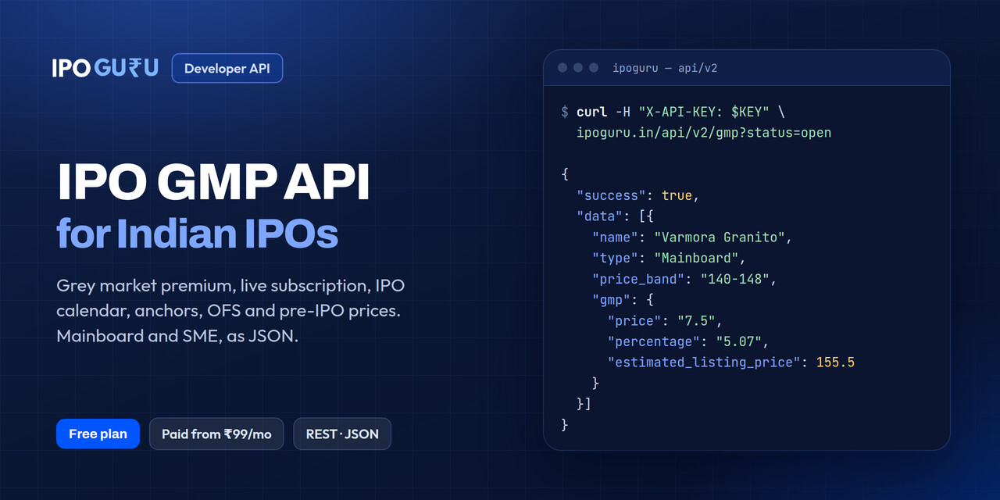

<!-- Generated from the live API reference. Edit the source on the server and re-run the export, not this file. -->
# IPO Guru API: IPO GMP, subscription & IPO calendar data for India



A REST API for Indian IPO data: **grey market premium (GMP)**, **live subscription** by category, the **IPO calendar** for Mainboard and SME issues, **anchor investors**, **Offer For Sale (OFS)** bids and **unlisted / pre-IPO share prices**.

This repository holds the public documentation, an [OpenAPI spec](openapi.json) and ready-to-run examples. The API itself is served from `https://www.ipoguru.in/api/v2`.

- **Free plan:** IPO calendar, IPO details and current GMP, no card needed.
- **Paid plans** from ₹99/month for full details, GMP history, live subscription, anchors, OFS and pre-IPO prices.
- **Get a key:** [Free sign-up in the developer portal](https://www.ipoguru.in/developer/login) (mobile OTP, takes a minute).
- **Pricing & live docs:** [ipoguru.in/ipo-gmp-details-developer-api](https://www.ipoguru.in/ipo-gmp-details-developer-api)

## Quick start

1. Sign up at the [developer portal](https://www.ipoguru.in/developer/login) and copy your API key. You see the full key only once, so keep it somewhere safe.
2. Send it in the `X-API-KEY` header:

```bash
curl -H "X-API-KEY: $IPOGURU_API_KEY" "https://www.ipoguru.in/api/v2/gmp?status=open"
```

3. You get JSON like this:

```json
{
  "success": true,
  "plan": "free",
  "count": 1,
  "data": [
    {
      "slug": "varmora-granito-ipo",
      "name": "Varmora Granito",
      "type": "Mainboard",
      "status": "Open",
      "price_band": "140-148",
      "gmp": {
        "price": "7.5",
        "percentage": "5.07",
        "estimated_listing_price": 155.5,
        "updated_at_label": "22 Sep 2026, 12:36 PM IST"
      }
    }
  ]
}
```

More examples: [curl](examples/curl) · [Python](examples/python) · [JavaScript / Node](examples/javascript) · [PHP](examples/php) · [Google Sheets](examples/google-sheets)

## Plans

| | **Free** | **Basic** | **Standard** | **Pro** |
|---|:---:|:---:|:---:|:---:|
| Price / month | Free | ₹99 | ₹299 | ₹499 |
| Price / year | — | ₹990 | ₹2,990 | ₹4,990 |
| Requests / day | 10 | 250 | 1,000 | 3,000 |
| Requests / minute | 1 | 10 | 20 | 40 |
| Best for | Try the API. IPO calendar, basic details and the current GMP. | Full IPO details and live GMP for a small site or app. | Day-wise GMP history, live subscription and anchor data. | The complete archive — intraday GMP, day-wise subscription, OFS and pre-IPO prices. |

Paying yearly gives 2 months free. Plans are paid by UPI inside the developer portal; you can upgrade at any time and pay only the difference. Need more throughput, webhooks or bulk history? [Contact us](mailto:info@ipoguru.in).

### What each plan can call

| Endpoint | Free | Basic | Standard | Pro |
|---|:---:|:---:|:---:|:---:|
| [`GET /ipos`](docs/endpoints.md#ep-ipos-list) | ✅ | ✅ | ✅ | ✅ |
| [`GET /ipos/{slug}`](docs/endpoints.md#ep-ipo-detail) | ✅ | ✅ | ✅ | ✅ |
| [`GET /gmp`](docs/endpoints.md#ep-gmp-all) | ✅ | ✅ | ✅ | ✅ |
| [`GET /ipos/{slug}/gmp`](docs/endpoints.md#ep-gmp-one) | ✅ | ✅ | ✅ | ✅ |
| [`GET /ipos/{slug}/gmp/history`](docs/endpoints.md#ep-gmp-history) | — | — | ✅ | ✅ |
| [`GET /ipos/{slug}/subscription`](docs/endpoints.md#ep-subscription) | — | — | ✅ | ✅ |
| [`GET /ipos/{slug}/subscription/history`](docs/endpoints.md#ep-subscription-history) | — | — | — | ✅ |
| [`GET /ipos/{slug}/anchors`](docs/endpoints.md#ep-anchors) | — | — | ✅ | ✅ |
| [`GET /ofs`](docs/endpoints.md#ep-ofs-list) | — | — | — | ✅ |
| [`GET /ofs/{slug}`](docs/endpoints.md#ep-ofs-detail) | — | — | — | ✅ |
| [`GET /unlisted`](docs/endpoints.md#ep-unlisted-list) | — | — | — | ✅ |
| [`GET /unlisted/{slug}`](docs/endpoints.md#ep-unlisted-detail) | — | — | — | ✅ |
| [`GET /me`](docs/endpoints.md#ep-me) | ✅ | ✅ | ✅ | ✅ |
| [`GET /plans`](docs/endpoints.md#ep-plans) | ✅ | ✅ | ✅ | ✅ |

On paid plans `GET /ipos/{slug}` also returns the company profile, financials, promoters, lot calculator, reservation, contacts and documents. On **Pro**, `GET /ipos/{slug}/gmp/history` adds the intraday timeline (11 AM / 5 PM / 10 PM IST points).

Check what your own key can do at any time with `GET /me`.

## Authentication

| | |
|---|---|
| Base URL | `https://www.ipoguru.in/api/v2` |
| Header | `X-API-KEY: <your key>` |
| Format | JSON, UTF-8. Dates `YYYY-MM-DD`; timestamps UTC ISO-8601, with an `_label` twin in IST for display |
| Identifiers | Use the `slug` from `/ipos` for every other IPO call, never the company name |

`?api_key=` in the query string also works, but use the header: query strings end up in logs and browser history.

**Keep your key on a server.** Never put it in a mobile app bundle, browser JavaScript or a public repo. If a key leaks, regenerate it in the portal.

## Endpoints

**IPOs**

| Method | Path | What it returns | From plan |
|---|---|---|---|
| `GET` | [`/ipos`](docs/endpoints.md#ep-ipos-list) | Every Mainboard and SME issue, newest first. This is the endpoint most integrations build their listing page on. | Free |
| `GET` | [`/ipos/{slug}`](docs/endpoints.md#ep-ipo-detail) | The full document for one issue: timeline, issue terms, GMP, subscription summary and listing performance — plus the editorial sections on paid plans. | Free |

**GMP**

| Method | Path | What it returns | From plan |
|---|---|---|---|
| `GET` | [`/gmp`](docs/endpoints.md#ep-gmp-all) | Grey Market Premium for every open and upcoming issue in a single call. Built so you never need one request per IPO. | Free |
| `GET` | [`/ipos/{slug}/gmp`](docs/endpoints.md#ep-gmp-one) | The latest grey-market reading for a single issue. | Free |
| `GET` | [`/ipos/{slug}/gmp/history`](docs/endpoints.md#ep-gmp-history) | The archive behind the live number: a day-wise series on Standard, plus the intraday timeline on Pro. | Standard |

**Subscription**

| Method | Path | What it returns | From plan |
|---|---|---|---|
| `GET` | [`/ipos/{slug}/subscription`](docs/endpoints.md#ep-subscription) | Bidding figures as they stand right now, as a category → sub-category tree. | Standard |
| `GET` | [`/ipos/{slug}/subscription/history`](docs/endpoints.md#ep-subscription-history) | How the book built up, day by day across the bidding window. | Pro |
| `GET` | [`/ipos/{slug}/anchors`](docs/endpoints.md#ep-anchors) | Who was allotted in the anchor book, for how much, with a roll-up by fund house. | Standard |

**OFS**

| Method | Path | What it returns | From plan |
|---|---|---|---|
| `GET` | [`/ofs`](docs/endpoints.md#ep-ofs-list) | Every tracked OFS, newest first, with its current subscription. | Pro |
| `GET` | [`/ofs/{slug}`](docs/endpoints.md#ep-ofs-detail) | One offer with its most recent bid snapshot, including the green-shoe split. | Pro |

**Pre-IPO**

| Method | Path | What it returns | From plan |
|---|---|---|---|
| `GET` | [`/unlisted`](docs/endpoints.md#ep-unlisted-list) | Every tracked unlisted company with its last traded price and 52-week band. | Pro |
| `GET` | [`/unlisted/{slug}`](docs/endpoints.md#ep-unlisted-detail) | One company with its valuation snapshot, listing outlook and full price history. | Pro |

**Account**

| Method | Path | What it returns | From plan |
|---|---|---|---|
| `GET` | [`/me`](docs/endpoints.md#ep-me) | What this key is allowed to do, and how much of today is left. Answers most support questions before they are asked. | Free |
| `GET` | [`/plans`](docs/endpoints.md#ep-plans) | The published plans, their prices and their scopes — read from the same config the API enforces. | Free |

Full field-by-field reference: **[docs/endpoints.md](docs/endpoints.md)**. Errors, limits and headers: **[docs/errors-and-limits.md](docs/errors-and-limits.md)**.

## Attribution (required on every plan)

The API is free to use with one condition: credit IPO Guru with a link wherever the data appears.

```html
IPO data by <a href="https://www.ipoguru.in/">IPO Guru</a>
```

| Where | What to do |
|---|---|
| Websites & blogs | A visible link on each page that shows the data, beside it or in the footer. |
| Apps | A visible "Data: IPO Guru" credit on the screens that show the data, linking to ipoguru.in, plus a link on the app's website or store listing. |
| Telegram bots & channels | The ipoguru.in link in the bot description and in every message that carries the data. |
| Excel & Google Sheets | A clickable ipoguru.in link on every sheet that shows the data, and on the download page. |

Keep it readable: not hidden with CSS, behind a click or shown to only some visitors. If the credit goes missing we will ask you to put it back, and a key may be paused if it stays off.

## Best practices

- **Cache on your side.** GMP moves a few times a day; subscription follows exchange releases. A 5–15 minute cache costs your users nothing and cuts quota use a lot.
- **Use the collection endpoints.** One call to `/gmp` replaces a loop over `/ipos/{slug}/gmp`.
- **Watch `X-RateLimit-Remaining`** and back off before you hit a `429`. On a per-minute `429`, wait for `Retry-After`.
- **Show the timestamp.** Display `updated_at_label` next to every GMP and subscription figure.
- **Never present GMP as advice.** It is an unofficial, unregulated signal. Label it that way.
- **Fail soft.** Treat a missing or `null` field as unknown and keep rendering the rest of the page.

## Terms of use (summary)

- **Not investment advice.** The API returns market data. Don't present it as advice, a recommendation or a prediction of listing gains.
- **Attribution** as above, on every plan.
- **No resale.** Raw responses may not be resold, redistributed or republished as a competing data feed.
- **One key per client.** Don't share keys across organisations or embed them in public client-side code.
- **No warranty.** Data comes from exchanges, registrars and grey-market sources and may lag or be unavailable. No liability is accepted for decisions taken on it.
- **Free plan** is for evaluation and non-commercial use.

The full terms are on the [developer page](https://www.ipoguru.in/ipo-gmp-details-developer-api#doc-terms).

## AI assistant skills

Want answers in Claude, ChatGPT or Gemini instead of code? [ipoguru/ipo-analysis-skills](https://github.com/ipoguru/ipo-analysis-skills) has ready-made IPO analysis skills (fundamentals, red flags, a GMP + subscription + analyst-sentiment screener) that read IPO Guru data. No API key needed.

## Support

- Questions about this documentation or the examples: [open an issue](../../issues). **Never paste your API key in an issue.**
- Billing, plan changes and anything about your account: [info@ipoguru.in](mailto:info@ipoguru.in)
- What changed recently: [CHANGELOG.md](CHANGELOG.md)

## License

The example code in this repository is released under the [MIT License](LICENSE). The data returned by the API is not; it is covered by the terms of use above.

---

IPO data by [IPO Guru](https://www.ipoguru.in/)
